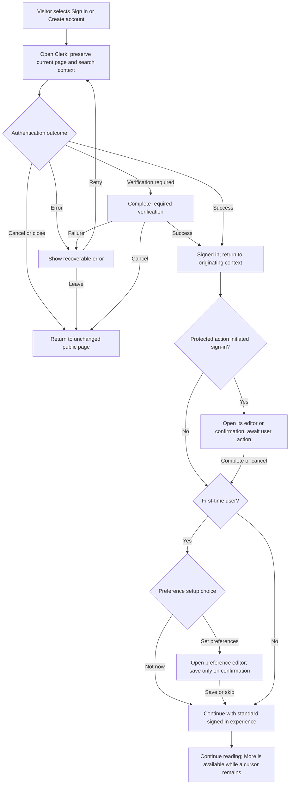

# User Management and Personalization UX

This specification covers Beans authentication, account actions, content preferences, and API keys. The first sections define user-visible behavior, permissions, and failure handling; [Implementation design and considerations](#implementation-design-and-considerations) defines the intended technical boundaries without providing code.

## Product boundaries

- Clerk provides authentication and account-management UI. Use its built-in sign-in, sign-up, sign-out, and account-deletion experiences where they meet this specification.
- Zuplo manages API keys. API keys are a developer capability and never replace a Beans user session.
- Personalization changes only what Beans retrieves and displays for its owner. It does not change public categories, global editorial ranking, source content, other users' views, or the Beans/Espresso services.
- Everyone can browse Now, categories, stories, sources, and Search. A visitor may use the page's **More** control once to append one additional result batch. After that, a **Sign in for more content** prompt replaces further continuation loading on that page until the user signs in. An account is required to continue loading beyond that visitor allowance or to persist personal preferences.
- A signed-in user's Home feed uses their saved preference settings when available; the default category tabs remain visible and available to everyone. There is no user-created custom page in this experience.
- A user's preferences and API keys are private and single-owner in this version. There is no sharing, collaboration, or public profile surface.

## User states and permissions

| State | Valid actions | Disallowed actions |
| --- | --- | --- |
| Visitor | Browse public content; use Home Find and Search; use **More** once per rendered public page to append the next available batch; start sign-in/sign-up. | Load a second continuation batch on that page before signing in; save a preference; manage API keys; delete an account. A temporary browser query must not be presented as a saved preference. |
| Authentication in progress | Complete, cancel, or recover sign-in/sign-up. | Open duplicate authentication dialogs; run account-only mutations; discard the originating route, query, filters, or visible results. |
| Signed-in user | Manage their own account, one active preference, API keys, and session; read their personalized Home and the default category pages. | Read, alter, revoke, publish, or delete another user's preference, account, or keys. |
| Expired/unavailable session | Continue public reading and sign in again. | Persist a draft, show private data from the stale session, or imply that an unsaved action succeeded. |
| Deletion pending | Review consequences, cancel, or explicitly confirm deletion. | Delete on one tap, continue account-only work after confirmation, or imply recovery unless the provider explicitly supports it. |

## Entry points and return behavior

- The header has one account control: **Sign in** for visitors; an identifiable account menu for signed-in users. The signed-in menu includes Account, Preferences, API keys, and Sign out.
- Selecting an account-only action while signed out explains the benefit in one short sentence and offers **Sign in** and **Create account**. It preserves the current location, query, filters, and results.
- A successful authentication returns the user to the action and context that initiated it. The protected action is resumed only after the appropriate editor or confirmation is visible.
- Cancelled, closed, or failed authentication returns to the unchanged originating experience. It must not create a preference, clear a search, or redirect to Account.
- Error messages are actionable but never expose provider tokens, internal account identifiers, or speculative explanations of account status.

## Sign-up and sign-in flow

1. The user selects **Sign in**, **Create account**, or an account-only action.
2. Beans opens the Clerk experience without replacing the underlying context.
3. The user signs in, signs up, completes required verification, cancels, or receives a recoverable error.
4. On success, the account control updates and Beans returns to the initiating context.
5. A first-time user is offered lightweight preference setup with **Set preferences** and **Not now**. Skipping is a valid completed onboarding path and leaves the normal public-style Home feed intact.

### Authentication state flow

The first-time preference offer waits until an initiating protected action is completed or cancelled, so it does not interrupt that action. Signing in restores access to **More** but never loads another batch automatically. Cancelling or failing authentication leaves the visitor's results and continuation position intact.

### Valid outcomes

- A verified sign-in/sign-up unlocks only the current user's private actions.
- A returning user sees their saved active preference on Home when one exists.
- A new user can defer personalization and start it later from Home or Account.
- The identity provider may ask for fresh verification before sensitive actions, such as account deletion or API-key management.

### Disallowed outcomes

- Creating an account must not automatically create a preference or key.
- Text entered before authentication is not a saved preference unless the user reviews and explicitly saves it after authentication.
- Do not gate public reading behind authentication.

## Sign out

- **Sign out** is available only from the signed-in account menu or account UI.
- It ends the session and returns to a safe public route—normally the current public page, otherwise Home.
- Account-only controls and personal indicators disappear after sign-out; public browsing remains available.
- If the user has unsaved edits, they must choose to continue editing, discard, or cancel sign-out. Draft loss cannot be silent.

### Disallowed behavior

- Signing out never deletes the account, preferences, or API keys.
- Signed-out views, page titles, and transient messages must not reveal personal data.
- A sign-out must not automatically sign the user back in or allow a protected mutation to finish afterward.

## Content preferences

### Purpose and presentation

- A preference is one saved set of optional discovery filters. It controls only the signed-in user's Home feed. It is not a promise of complete, neutral, or fact-checked coverage.
- The preference editor provides these fields, using comma-separated entries for the list fields:

  | Field | User-facing purpose | Feed filter |
  | --- | --- | --- |
  | Topic | Generic text query for semantic/vector search. | `q` |
  | Tags | Topics to include, entered like Tags on `/search`. | `tags` |
  | Sources | Publisher domains to include, entered like Sources on `/search`. | `domains` |
  | Exclude sources | Publisher domains to omit, in the same format as Sources. | `exclude_domains` |
  | Languages | Language values for the preferred Home feed. | `languages` |

- Each field is optional, but at least one field must contain a valid value before **Save preferences** is enabled. An empty preference is cleared through **Clear preferences**, not saved as a new setting.
- Signed-in users with no saved preference see a compact Home prompt to set one. Users with an active preference see a concise summary of the saved filters and **Edit**/**Clear** actions. The editor explains that these filters change only their signed-in Beans Home feed.
- Home visibly identifies a personalized feed, for example with “Following your preferences.” The existing default category tabs stay in place for signed-in and signed-out users. Opening a category shows that category's normal feed, independent of the Home preference.
- If a user skips setup or clears their preference, their Home shows the default public-style discovery feed while they remain signed in.

### Save, edit, and clear flow

1. A signed-in user opens Preferences from Home or Account.
2. They enter or revise a Topic and any comma-separated Tags, Sources, Exclude sources, and Languages.
3. The interface trims entries, removes blank list items, and shows field-specific validation. Sources and Exclude sources use the same domain-name format as `/search`; Languages must be values accepted by the news feed. The same source cannot be both included and excluded.
4. **Save preferences** is available when at least one field is valid and no field has an error. During saving, prevent duplicate submission and retain all entered values.
5. On success, show the saved filter summary and refresh Home using those filters when the user returns to it. Keep the currently viewed story or category in place.
6. On failure, preserve every edited field, show a retryable error, and state that the previous saved preference, if any, remains active.
7. **Clear preferences** requires confirmation when a preference exists. On confirmation, restore the default signed-in Home feed; it does not sign the user out or alter category pages.

### Valid actions

- Create, view, replace, or clear one preference set while signed in.
- Save any valid combination of Topic, Tags, Sources, Exclude sources, and Languages. List fields accept comma-separated values and are summarized as distinct entries after saving.
- Use Home Find or `/search` temporarily without changing the saved Home preference. Only an explicit preference save replaces it.

### Disallowed actions and guardrails

- Do not save a completely empty preference, over-limit text, unsupported language, malformed domain, conflicting include/exclude source, or other failed-validation input; preserve the draft and explain the correction per field.
- Do not auto-save while typing, infer a preference from reading history, or replace saved filters because a Home query changed.
- Do not hide personalization or suggest it changes public categories/upstream data.
- Do not use preference values to create an API key, enroll notifications, or share data.
- Do not place raw preference values in public URLs, sharing metadata, or non-essential telemetry.

## API keys

API keys are for the signed-in user's own developer use and are managed in the Zuplo experience.

- **API keys** requires a valid session and, if required by the provider, recent re-authentication.
- **API keys** are managed entirely through Zuplo hosted developer portal https://developer.cafecito.tech

### Disallowed API-key actions

- Never redisplay a full existing secret, put it in a URL/log/analytics event, or show it to another user.
- Never create keys for visitors, stale sessions, or a different account.
- Do not describe revocation as rotation without warning that integrations using the old key can stop working.
- A key must not grant account-management access or bypass Beans UI permissions.

## Account deletion

- Deletion is available only in the signed-in account-management experience and may require re-authentication.
- Before confirmation, state that the user will lose Clerk account access and their Beans preferences. Zuplo uses a separate login; API keys and portal access must be managed there separately. Link an applicable retention policy when available.
- The destructive control has an explicit confirmation step; cancellation returns to Account unchanged.
- A successful deletion ends the session, removes account-only UI, and shows a neutral completion state with a recovery/contact route only when one is actually supported.
- A failed deletion must not sign the user out prematurely or claim completion; retain a safe account state and offer retry/support.

### Disallowed deletion behavior

- Do not allow a visitor or URL/query parameter alone to trigger deletion.
- Do not delete on one accidental tap, imply sign-out deletes an account, or conceal loss of API-key access/personal content.
- Do not promise immediate erasure, recovery, or downstream deletion guarantees unsupported by the provider or retention policy.

## Cross-cutting interaction requirements

- The visitor continuation allowance applies to the user-operated **More** controls on Home, category, source, Search, and Story Related lists. The initial page content remains fully viewable. A visitor's first successful **More** action appends the normal next batch, then replaces/hides **More** and appends a clearly labeled **Sign in for more content** prompt after the rendered list.
- The prompt opens the standard authentication flow and preserves the route, query, filters, currently rendered results, and pagination position. After successful sign-in, normal continuation loading is enabled; do not silently fetch another batch without an explicit user action.
- Until sign-in succeeds, any remaining continuation controls on that page are disabled or unavailable and must not issue an additional content request. Retrying a failed allowed request does not consume a second continuation allowance; no successful extra batch may be appended from that retry.
- Controls are keyboard-operable, visibly focused, clearly named, and announce validation, saving, success, and failure without color alone.
- On narrow screens, menus/dialogs remain within the viewport with a clear cancel/close path and no horizontal overflow.
- Pending save/create/revoke/delete actions prevent duplicate requests; cancellation is never treated as success.
- Network, rate-limit, and session errors say what happened, whether the prior saved state remains intact, and the next valid action. They must never fabricate success.
- Personal data is minimized in UI copy, URLs, notifications, telemetry, and errors. No raw preference text or API secret appears in public sharing metadata.

## Implementation design and considerations

The implementation stays inside the Nuxt application and its application-owned user database; Beans and Espresso services are unchanged.

The selected Option A utility-icon placement is shown in the [user-management mockup](./user-management-option-a.png).

### Current architecture to preserve

- Keep the Nuxt/Nitro presentation-action boundary. Browsers call same-origin actions; Beans/Espresso credentials remain server-only.
- Keep initial Home, category, source, Search, and Story content server-rendered. Authentication must not turn public pages into client-only shells or delay public content behind Clerk.
- Preserve existing cursor safety, duplicate removal, request-generation guards, timeouts, Retry-After handling, and visible-content-on-error behavior. Authentication and continuation access add policy; they do not replace those protections.
- Use Nuxt UI and shared Beans styles. Account, prompt, and continuation state should be reusable rather than duplicated by page.

| Surface | Existing continuation | Visitor policy scope |
| --- | --- | --- |
| Home | Feed `cursor` | One successful More batch for Home. |
| Category | Feed `cursor` | One per category. |
| Source | `source_cursor` | One per source. |
| Search | Search `cursor` | One per normalized committed query/filter definition. |
| Story | Related `cursor` | One per story's Related list. Initial Coverage remains public and is not truncated by this rule. |

### Authentication and identity boundary

- Clerk is the identity source. Verify its session on the server for every protected read or mutation; client `is_signed_in` state is presentation state, never authorization proof.
- Put only the stable Clerk user ID and necessary session/freshness state in the server request context. Never copy provider tokens into application state, URLs, logs, or telemetry.
- Continue using a signed, HttpOnly anonymous browser identity for signed-out continuation and rate-limit decisions. After sign-in, authorization uses the Clerk identity. Do not merge anonymous activity into an account without a separate explicit product rule.
- Validate post-authentication return targets as same-origin Beans paths. Arbitrary external return URLs are disallowed.
- Resolve auth during SSR and hydrate from the same state to avoid visitor-control flashes for signed-in users or stale private controls after sign-out.
- If Clerk is unavailable, public reading remains available. Personal actions fail closed with an actionable message; cached client state cannot substitute for a verified session.

### Visitor continuation enforcement

The visitor allowance is enforced on the server as well as represented in the UI.

- Centralize the rule across `feed`, `search`, and `related` presentation actions. A non-empty story, source, Search, or Related cursor is a continuation; an initial request is not.
- Scope the allowance by signed anonymous identity plus a normalized page-context fingerprint: Home, category ID, source ID, Story ID/Related, or normalized Search query/tags/domains. Store only hashes required for enforcement, not raw Search or preference text.
- Treat the allowance as one successful continuation per page context—not one per Vue mount. Refresh, hydration, Back/Forward, or reopening the same context must not restore **More**. A different category/source/story or materially different committed Search is a new context.
- Return a server-signed continuation context with the initial snapshot. Bind it to the anonymous identity, surface, normalized context, expected cursor, issue time, and expiry. Reject missing, expired, replayed, mismatched, or altered contexts before upstream work.
- Use a shared production store with atomic `reserved`, `consumed`, and released/expired states. Reserve before upstream work to prevent concurrent double loads; mark consumed after a successful allowed response; release after a definite failure so Retry remains valid. A crashed reservation expires.
- A successful allowed request consumes the allowance even if its batch is empty or contains only duplicates. When no cursor remains, show the natural end state. When another cursor remains, return `sign_in_required` and show **Sign in for more content**.
- A blocked second continuation performs no Beans/Espresso request. Disabled buttons, client counters, raw cursors, and the general rate-limit cookie are not sufficient enforcement.
- Rate limiting remains independent. A 429, timeout, validation failure, or upstream error may affect action quota under the existing policy but must not consume the successful-continuation allowance.
- Signed-in users bypass only this visitor gate and continue normally until cursor exhaustion, still subject to validation and rate limits. Sign-in enables **More** without automatically fetching. Session expiry preserves rendered content and returns the page to `sign_in_required` for further continuation.
- Cookie clearing can reset an anonymous conversion allowance. This is acceptable only if the restriction remains a UX/conversion prompt rather than a security or payment boundary. A stronger identity policy requires separate privacy review; do not silently use broad IP-only blocking that can affect shared networks.

### Shared continuation state

| State | Rendering and permitted action |
| --- | --- |
| `available` | Show **More**; permit one explicit visitor continuation. |
| `loading` | Retain cards, show progress, and block duplicate clicks. |
| `retryable_error` | Retain cards; Retry uses the same unconsumed allowance and cursor. |
| `sign_in_required` | Replace More with the sign-in prompt after the list. |
| `exhausted` | Render neither More nor a misleading sign-in promise. |
| `authenticated_available` | Show normal More while a cursor remains. |

- Implement this state once in a continuation-access composable/view model. Feed/Search composables own data and cursors; the access model owns whether continuation is permitted and which footer control appears.
- Extend the shared article-section footer to render More, Retry, the sign-in prompt, or the natural end state. Story Related should use the same contract even if its list markup remains specialized.
- Announce appended results and the sign-in requirement accessibly without unexpected focus movement. The prompt must remain keyboard-operable and fit at 320px.
- Telemetry may record surface, state transition, and counts. It must exclude raw searches/preferences, Clerk IDs, continuation tokens, and API keys.

### Personalization data and precedence

- Keep authentication records in Clerk. Store the Beans-owned preference set separately, keyed by stable Clerk user ID. Never store passwords, provider verification data, or session tokens.
- Use the configured PostgreSQL database in production and local development, with an explicit SQLite alternative for local development, behind one typed repository/migration boundary. Vue components and route handlers should not contain database-dialect behavior.
- Suggested logical records:
  - `user_preferences`: unique owner ID, optional topic text, normalized tags, included domains, excluded domains, languages, schema version, timestamps, and concurrency version.
  - `continuation_usage`: hashed anonymous identity/context, reservation/consumed state, expiry, and timestamps, with an identity-plus-context uniqueness constraint.
  - `account_cleanup`: idempotency key, owner ID, cleanup state, attempts, and last failure for cross-provider reconciliation.
- Validate and normalize at the server write boundary. Browser validation gives early feedback but is not authoritative. Use the existing `/search` normalization rules for Tags and included Sources; apply the same domain rules to Exclude sources. Validate Languages against values supported by the feed and reject a domain present in both source lists.
- Load the signed-in Home preference on the server and map its saved fields to `q`, `tags`, `domains`, `exclude_domains`, and `languages` for the Home feed. Send list values as repeated query parameters under the data-source convention. If Languages is empty, retain the existing default English-language filter; if Topic is empty, omit `q` and its score threshold.
- Personalized Home HTML and data responses are private/no-store and excluded from shared public caches. Pagination, Retry, and refresh keep the same saved filter set until the user edits or clears it.
- An explicit Home query or committed `/search` applies to that request but does not overwrite the saved preference. Saving/replacing remains a distinct mutation. Default category tabs and category feeds keep their existing behavior regardless of the Home preference.
- Use optimistic concurrency or conditional updates so two tabs cannot silently overwrite a newer preference edit.

### Account and provider integration

- Provision local Beans data lazily when the user first saves a preference; Clerk sign-up alone need not create a local row.
- Handle Clerk deletion through verified, idempotent webhooks or an equivalent provider-supported flow. Local personalization deletion and external API-access cleanup are separate steps; retry/reconcile partial failures instead of claiming atomic cross-provider deletion.
- Keep API-key creation, display, and revocation entirely in the Zuplo portal at `https://developer.cafecito.tech`. Beans stores no API-key secret and passes no Beans session or secret in the portal URL. Any later SSO must use a provider-supported signed handoff and a validated return target.
- Confirm Clerk, Zuplo, and Beans retention/deletion behavior before finalizing deletion copy. Promise only what all integrated systems can guarantee.

### Failure and security guardrails

- If personal storage is unavailable, public content remains readable; personal operations fail closed and saved state is not replaced with empty defaults.
- If auth expires during a mutation, reject it, retain a safe draft, and request authentication. Do not automatically replay a mutation after sign-in.
- Prevent duplicate submission in the UI and enforce idempotency/uniqueness on the server for fast clicks, concurrent tabs, retries, and webhook redelivery.
- Route/filter changes invalidate older continuation or personal responses through generation guards. Stale responses cannot replace current auth, cursor, preference, or prompt state.
- Never shared-cache authenticated HTML, account responses, or preference-bearing feeds. Clear private client state before rendering a signed-out view.
- Keep personal text and secrets out of access logs, exceptions, telemetry, history, and support-visible error messages.

### Delivery sequence

1. Add Clerk session resolution, SSR-safe account controls, protected-action helpers, cache isolation, and safe return-context handling.
2. Add centralized continuation enforcement/storage and shared continuation UI across all five public surfaces.
3. Add persistence and validation for Topic, Tags, Sources, Exclude sources, and Languages; apply the saved filters to signed-in Home, including edit/clear and draft-preserving failures.
4. Add verified account-cleanup orchestration and the authenticated Zuplo portal handoff.

Each phase must be independently releasable and reversible. Do not expose a control before its server authorization and failure handling are active.

### Verification design

- Unit tests cover the permission/state matrix, normalized context hashing, continuation reserve/complete/release transitions, five-field validation and normalization, return-target checks, ownership, and preference/query precedence.
- Server integration tests prove direct actions cannot bypass visitor gating, concurrent More requests yield at most one success, failed allowed requests remain retryable, and signed-in sessions bypass only the continuation gate.
- SSR/cache tests prove public content remains server-rendered/indexable, personalized responses are private, hydration does not duplicate initial requests, and signed-out HTML contains no personal data.
- Browser tests cover all five surfaces, sign-in cancellation/success, session expiry, Back/Forward, refresh of an exhausted context, new Search context, cursor exhaustion, rate-limit interaction, multiple tabs, keyboard operation, and 320px layout.
- Persistence tests cover preference owner isolation, optimistic conflicts, idempotent deletion/webhooks, PostgreSQL/SQLite migration parity, and partial-cleanup recovery.
- Telemetry tests reject raw preferences, searches, identity IDs, provider tokens, continuation contexts, and API secrets.

### Selected implementation decisions

- Use the official Clerk Nuxt SDK and server-verified session tokens. Local work stays on the configured development instance.
- Use Kysely with PostgreSQL/SQLite repositories and migrations. The user database also stores atomic continuation reservations.
- Use current API source-name and language values; apply the field limits documented below.
- Anonymous allowance lasts until the existing identity expires, up to 30 days. Cookie removal can reset this conversion prompt.
- Zuplo uses separate login and separate key/account cleanup. Clerk deletion triggers verified local preference cleanup; provider redelivery and the reconciliation command handle retries.
- Explicit Home Find temporarily replaces all saved filters; clearing it restores the preference.

## Acceptance and failure checks

| Scenario | Success criterion | Failure guardrail |
| --- | --- | --- |
| Sign in from Search | The user returns to the same query/results and can deliberately save a page. | Cancellation/failure changes nothing and creates nothing. |
| Visitor continuation | Home, category, source, Search, and Story Related each append one successful More batch, then show Sign in for more content. | A second continuation request cannot be issued or render until the visitor signs in; initial content and the first appended batch remain visible. |
| First sign-up | The user can set a preference or select Not now. | No preference is silently created; public browsing remains available. |
| Preference save | A confirmed valid set of Topic, Tags, Sources, Exclude sources, and/or Languages becomes active on Home. | Empty, conflicting, unsupported, or failed input preserves the draft and prior preference. |
| Personalized Home | The signed-in Home uses all saved filters while the default category tabs and feeds remain available. | More, Retry, or a category visit cannot drop filters, alter the saved preference, or change a category feed. |
| Preference clear | Confirmation restores default signed-in discovery. | No sign-out or stale personalized label. |
| Sign out | Session ends; public reading remains possible. | Personal data is hidden and nothing is deleted. |
| Delete account | Consequences, confirmation, and completion/failure status are accurate. | One-click or unsupported-recovery deletion claims are impossible. |

## Implemented application contracts — 2026-10-27

- Local Clerk configuration remains on the development instance. `@clerk/nuxt` supplies SSR state and the provider UI; Beans' middleware verifies session tokens and fails closed for personal actions while public reading remains available.
- `BEANS_APP_USER_DB` configures the server-owned database (runtime override `NUXT_USER_DB`). Kysely repositories support PostgreSQL and explicit SQLite development storage. Migrations are run with `pnpm db:migrate`, not automatically during requests. Preferences are provisioned on first explicit Save.
- `/api/account/session` returns verified sign-in presentation state, the owner's preference, and any storage error. `/api/account/preferences` supports authenticated GET, POST `{ preference, version }`, and DELETE `{ version }`. Owner identity comes from Clerk, never the request body. POST/DELETE require same-origin requests; stale versions return 409. Clear retains a version tombstone to prevent an older edit matching a recreated preference.
- Topic is limited to 500 characters. Each list accepts up to 30 entries; tags are limited to 500 characters per entry and source names to 253. List normalization trims, removes blanks, deduplicates, lowercases, and converts spaces in tags to underscores. Sources accept stored source names without schemes, paths, or whitespace. Languages are restricted to `NEWS_LANGUAGES`; included/excluded source overlap is invalid.
- Home precedence is temporary Find → saved preference → existing public discovery. Find temporarily replaces all saved filters; clearing Find restores them. Preferences never populate browser query/cookie persistence. Effective preference filters are carried in signed continuation snapshots and bypass shared upstream caches.
- Continuation snapshots expose `continuation_access`: available, retryable_error, sign_in_required, exhausted, or authenticated_available. The UI also represents loading. Tokens bind anonymous identity, account when applicable, surface/context, filters, and expected cursor, and expire after 30 minutes. `/api/account/continuation` renews a token after verifying its signature and current access; renewal does not load content or restore allowance.
- The anonymous ledger lasts until identity expiry, up to 30 days. PostgreSQL atomic reservations use a 120-second lease and owner-checked completion/release. Failed collection requests release the reservation; empty/duplicate-only successful batches consume it. Consumed-context refresh/reopening remains gated. Different normalized Search criteria/category/source/story contexts have separate allowances; Home keeps one context across temporary Find changes.
- `/api/webhooks/clerk` verifies the provider signature, queues `user.deleted` cleanup durably, then deletes preferences idempotently. Pending cleanup blocks preference recreation. `pnpm db:reconcile` retries queued cleanup and prunes expired continuation records; provider delivery retries remain necessary when storage itself is unavailable.
- API keys remain entirely at `https://developer.cafecito.tech` with separate login. Beans neither stores keys nor revokes Zuplo access on deletion. The account UI discloses this boundary. No provider dashboard settings, production-instance configuration, or Zuplo SSO are changed by this implementation.

- Context enforcement canonicalizes empty, duplicate, comma-separated, whitespace and case variants of category/Search selectors; selector-free feed requests are Home regardless of the legacy `home_default` hint. UUID IDs are canonicalized without changing case-sensitive opaque IDs. These equivalent requests share the same allowance.
- Account UI closes on expired/unverifiable sessions while retaining a same-owner draft for explicit re-authentication and review. A different owner resets that draft. Sign-out requires a loaded provider, preserves public query/hash context, and never claims success when the provider fails. Unknown network outcomes use “not confirmed” copy and require checking the saved version before retrying.
